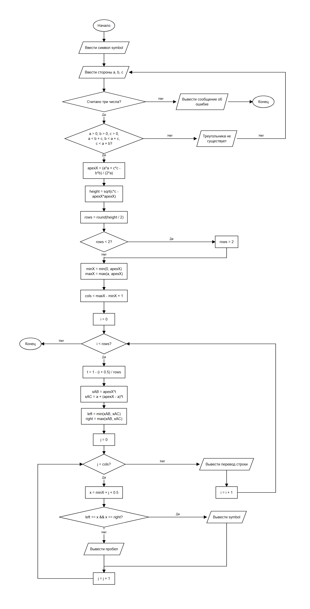

# Индивидуальное задание к теме 9

## Условие задачи
Написать программу, которая выводит на экран треугольник, нарисованный заданным с клавиатуры символом. Контур заполнен (заполнение: да). Задаваемые параметры: стороны треугольника **a**, **b**, **c**. (Задача А, вариант 14)

Сторона **a** — основание треугольника (отрезок BC), **b** — сторона AC, **c** — сторона AB, как на рисунке задания. Треугольник существует, если каждая сторона меньше суммы двух других: **a < b + c**, **b < a + c**, **c < a + b**.

## 1. Алгоритм и блок-схема

### Алгоритм
1. **Начало**
2. Ввести символ **symbol**, которым будет нарисован треугольник.
3. Повторять (цикл do-while), пока треугольник с введёнными сторонами не существует:
   - ввести **a**, **b**, **c**; если введено не три числа, вывести сообщение и завершить программу;
   - проверить, что **a > 0**, **b > 0**, **c > 0**, **a < b + c**, **b < a + c**, **c < a + b**; если условие не выполнено, вывести сообщение о том, что треугольника с такими сторонами нет.
4. Вычислить координаты вершины A при B(0; 0) и C(a; 0):
   - **apexX = (a·a + c·c − b·b) / (2·a)**;
   - **height = √(c·c − apexX·apexX)**.
5. Вычислить число строк: **rows = round(height / 2)**, но не меньше 2. Символ в консоли примерно вдвое выше, чем шире, поэтому одна строка соответствует двум единицам высоты.
6. Вычислить число столбцов: **minX = min(0, apexX)**, **maxX = max(a, apexX)**, **cols = maxX − minX + 1**.
7. Для каждой строки **i** от 0 до **rows − 1** (сверху вниз):
   - **t = 1 − (i + 0.5) / rows** — относительная высота середины строки;
   - **xAB = apexX · t**, **xAC = a + (apexX − a) · t** — границы треугольника на этой высоте;
   - **left = min(xAB, xAC)**, **right = max(xAB, xAC)**;
   - для каждого столбца **j** от 0 до **cols − 1**: **x = minX + j + 0.5**; если **left ≤ x ≤ right**, вывести **symbol**, иначе вывести пробел;
   - перейти на новую строку.
8. **Конец**

### Блок-схема


## 2. Реализация программы

```c
#define _CRT_SECURE_NO_DEPRECATE

#include <stdio.h>
#include <stdlib.h>
#include <math.h>

#define ROW_HEIGHT 2

int main() {
    char symbol;
    double a, b, c, apexX, height, minX, maxX, t, xAB, xAC, left, right, x;
    int valid, rows, cols, i, j;

    system("chcp 65001 > nul");

    puts("Введите символ, которым нарисовать треугольник");
    scanf(" %c", &symbol);

    do {
        puts("Введите стороны a, b, c через пробел");
        if (scanf("%lf %lf %lf", &a, &b, &c) != 3) {
            puts("Нужно ввести три числа");
            return 1;
        }
        valid = a > 0 && b > 0 && c > 0 && a < b + c && b < a + c && c < a + b;
        if (valid == 0)
            puts("Треугольника с такими сторонами не существует");
    } while (valid == 0);

    apexX = (a * a + c * c - b * b) / (2 * a);
    height = sqrt(c * c - apexX * apexX);
    rows = (int)(height / ROW_HEIGHT + 0.5);
    if (rows < 2)
        rows = 2;
    minX = apexX < 0 ? apexX : 0;
    maxX = apexX > a ? apexX : a;
    cols = (int)(maxX - minX) + 1;

    for (i = 0; i < rows; i++) {
        t = 1 - (i + 0.5) / rows;
        xAB = apexX * t;
        xAC = a + (apexX - a) * t;
        left = xAB < xAC ? xAB : xAC;
        right = xAB < xAC ? xAC : xAB;
        for (j = 0; j < cols; j++) {
            x = minX + j + 0.5;
            printf("%c", left <= x && x <= right ? symbol : ' ');
        }
        printf("\n");
    }

    system("pause");
    return 0;
}
```

## 3. Результаты работы программы

Треугольник со сторонами 10, 10, 10 (равносторонний):

```
Введите символ, которым нарисовать треугольник
*
Введите стороны a, b, c через пробел
10 10 10
    **
   ****
  ******
 ********
```

Треугольник со сторонами 15, 20, 25 (символ x):

```
Введите символ, которым нарисовать треугольник
x
Введите стороны a, b, c через пробел
15 20 25
              x
             xx
           xxxx
          xxxxx
        xxxxxxx
       xxxxxxxx
     xxxxxxxxxx
    xxxxxxxxxxx
  xxxxxxxxxxxxx
 xxxxxxxxxxxxxx
```

Неверные стороны 1, 2, 10: программа сообщает, что треугольника нет, и просит ввести стороны снова:

```
Введите символ, которым нарисовать треугольник
#
Введите стороны a, b, c через пробел
1 2 10
Треугольника с такими сторонами не существует
Введите стороны a, b, c через пробел
12 12 12
     ##
    ####
   ######
  ########
 ##########
```

## 4. Информация о разработчике
Сбоев Даниил, бОТИ-261
